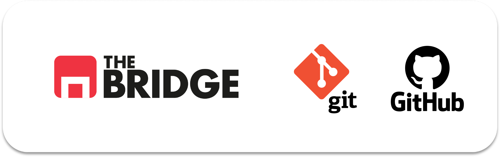

# 🌿 Taller 01 · Git & GitHub

Lo mínimo para trabajar en equipo en el bootcamp: hacer commits, crear ramas, resolver un conflicto sencillo, subir a GitHub y abrir una Pull Request hacia `develop`, como en los Team Challenges.

*Versión revisada · noviembre 2026 · sesión de 90 minutos online.*

---

## ✅ Antes de la sesión

Haz el **pre-work** ([prework_git.md](./prework_git.md)): instalar Git, VS Code y GitHub CLI, iniciar sesión con `gh auth login` y pegar el bloque de configuración. En la sesión no hay tiempo para instalar.

---

## 📂 Contenido

### 📄 Notebook del taller

🔗 [git_masterclass.ipynb](./git_masterclass.ipynb)

1. ¿Qué es Git? Las tres zonas y el commit
2. Primeros comandos, `.gitignore` y claves en `.env`
3. Ramas, merge y conflictos
4. GitHub: push, pull y Pull Requests
5. El flujo de ramas de los Team Challenges (`feature/*` → `develop` → `main`)
6. Buenas prácticas: mensajes de commit y notebooks en equipo
7. Chuleta de comandos
8. Ampliación (opcional)

Cuatro ejercicios: primer repo, ramas con conflicto, subir a GitHub y ensayo del Team Challenge.

### 📖 Guía para alumnos

🔗 [guia_git_alumnos.html](./guia_git_alumnos.html): el mismo contenido que el notebook, en formato web navegable y con botones para copiar los comandos.

### 🛠️ Script de demo

🔗 [scripts/demo_gitflow.sh](./scripts/demo_gitflow.sh): construye un repo con el Gitflow completo (feature, release, hotfix y tags) para enseñarlo en pantalla. Es también la solución del ejercicio opcional.

```bash
PAUSA=1 bash scripts/demo_gitflow.sh     # se para en cada paso
```
